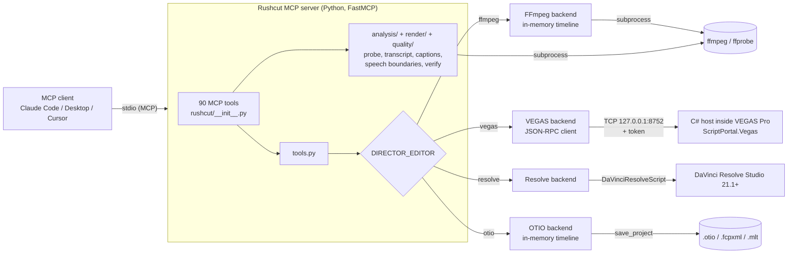

<p align="center">
  <picture>
    <source media="(prefers-color-scheme: dark)" srcset="docs/assets/logo-dark.svg">
    
  </picture>
</p>

# Rushcut MCP

**Rushcut: AI video editing over MCP. Point any agent at your footage; get edits from FFmpeg, VEGAS Pro, DaVinci Resolve or an OTIO/FCPXML/MLT timeline.**

[](https://github.com/RFingAdam/rushcut/actions/workflows/ci.yml)
[](LICENSE)
[](server/pyproject.toml)
[](https://modelcontextprotocol.io)

Rushcut MCP is a [Model Context Protocol](https://modelcontextprotocol.io)
server (Python, [FastMCP](https://github.com/jlowin/fastmcp)) that exposes
**90 video-editing tools** to any MCP client: Claude Code, Claude Desktop,
Cursor, or anything else that speaks stdio MCP. The same tool names
(`add_track`, `place_media`, `trim_event`, `set_event_fades`,
`render_with_preset`, ...) drive whichever backend you select with
`DIRECTOR_EDITOR`, so an agent's workflow does not change when you switch
editors.

- **FFmpeg-first.** The headless backend keeps an in-memory timeline and
  renders with `ffmpeg`. No GUI editor, no license, runs on Windows, macOS and
  Linux.
- **Live NLE control when you want it.** Drive a running MAGIX VEGAS Pro
  (C# host over loopback TCP) or DaVinci Resolve Studio (official scripting
  API), and read the timeline back after every change.
- **Inspect, edit, verify.** Grounding tools (`probe_media`, `detect_scenes`,
  `analyze_audio`, optional local Whisper with word timestamps) and render
  checks (`verify_output`, `rushcut check`) let the model check its own work.

> **Formerly vegas-director-mcp.** Old import names, `python -m` entry
> points and console scripts keep working for one release, and MCP tool names
> are unchanged. See [docs/MIGRATION.md](docs/MIGRATION.md).

**Independent project.** Not affiliated with or endorsed by MAGIX or
Blackmagic Design. See [NOTICE](NOTICE).

## Contents

- [Backends](#backends)
- [60-second quickstart](#60-second-quickstart)
- [Register with your MCP client](#register-with-your-mcp-client)
- [Tool catalog](#tool-catalog)
- [Quality checks](#quality-checks)
- [Example: a headless FFmpeg edit](#example-a-headless-ffmpeg-edit)
- [Story formats & pacing](#story-formats--pacing)
- [Architecture](#architecture)
- [Configuration](#configuration)
- [Security](#security)
- [Troubleshooting](#troubleshooting)
- [Roadmap](#roadmap)
- [Contributing](#contributing)
- [License](#license)

## Backends

| `DIRECTOR_EDITOR` | Backend | Live? | Requirements | Notes |
|---|---|---|---|---|
| `ffmpeg` (aliases `ff`, `headless`) | Headless FFmpeg | No | `ffmpeg` + `ffprobe` on PATH | In-memory timeline, rendered to MP4 by `render_start` / `render_with_preset`. Transport tools are unsupported (no GUI). |
| `vegas` (default) | MAGIX VEGAS Pro via `ScriptPortal.Vegas` | Yes | Windows, licensed VEGAS Pro 22+ (VEGAS Pro 2027 is detected too) | C# host inside VEGAS on `127.0.0.1:8752`. Application Extension (auto-start) or Script Menu mode. Native Titles & Text, VideoMotion, render templates. |
| `resolve` (aliases `davinci`, `davinci-resolve`) | DaVinci Resolve via `DaVinciResolveScript` | Yes | **Resolve Studio 21.1+**, Preferences > System > General > External scripting = Local | The free edition has no scripting API since 21.1. Studio extras: subtitles from audio, Smart Reframe, voice isolation. |
| `otio` (aliases `fcpxml`, `mlt`, `kdenlive`, `shotcut`) | In-memory timeline interchange | No | Nothing extra | `save_project` writes `.otio`, `.fcpxml` or `.mlt`. Timeline I/O only, not a renderer. |

`vegas` stays the default so existing installs keep working. For a first run,
set `DIRECTOR_EDITOR=ffmpeg`. Call `list_editors`, `editor_info` and
`editor_capabilities` from the agent to see what the active backend implements
fully, partially, or not at all. Coverage details:
[docs/API_COVERAGE.md](docs/API_COVERAGE.md) and [docs/EDITORS.md](docs/EDITORS.md).

## 60-second quickstart

Requires Python 3.11+ and `ffmpeg` / `ffprobe` on PATH
(`winget install ffmpeg`, `brew install ffmpeg`, or `apt install ffmpeg`).
The package is not on PyPI yet, so install from a clone:

```bash
git clone https://github.com/RFingAdam/rushcut.git rushcut
cd rushcut/server
python -m venv .venv
source .venv/bin/activate          # Windows: .venv\Scripts\activate
pip install -e .                   # add ".[whisper]" for local transcription
                                   # ".[analysis]" for numpy STFT / encode-aware TP
                                   # ".[denoise]" for optional DeepFilterNet
```

Smoke-test it without an MCP client:

```bash
DIRECTOR_EDITOR=ffmpeg python -c "from rushcut.tools import ping; print(ping())"
# PowerShell: $env:DIRECTOR_EDITOR="ffmpeg"; python -c "from rushcut.tools import ping; print(ping())"
```

Run the server (stdio; your MCP client normally starts it for you):

```bash
DIRECTOR_EDITOR=ffmpeg rushcut-mcp      # or: python -m rushcut
```

Live editors need one more step: VEGAS host install in
[docs/SETUP.md](docs/SETUP.md), Resolve Studio setup in
[docs/RESOLVE.md](docs/RESOLVE.md). Headless details in
[docs/FFMPEG.md](docs/FFMPEG.md).

## Register with your MCP client

Point the client at the venv's Python (or the `rushcut-mcp` script inside
the venv). Use absolute paths. Replace `/path/to/rushcut` with your clone.

**Claude Code** (CLI):

```bash
claude mcp add rushcut --env DIRECTOR_EDITOR=ffmpeg -- /path/to/rushcut/server/.venv/bin/python -m rushcut
# Windows: ... -- C:\path\to\rushcut\server\.venv\Scripts\python.exe -m rushcut
```

**Claude Desktop** (`claude_desktop_config.json`; on Windows
`%APPDATA%\Claude\claude_desktop_config.json`, on macOS
`~/Library/Application Support/Claude/claude_desktop_config.json`):

```json
{
  "mcpServers": {
    "rushcut": {
      "command": "/path/to/rushcut/server/.venv/bin/python",
      "args": ["-m", "rushcut"],
      "env": { "DIRECTOR_EDITOR": "ffmpeg" }
    }
  }
}
```

On Windows you can instead run `py -3 scripts\register_claude.py` from the
repo root once the venv exists. It backs up the config, writes a
`"rushcut-mcp"` entry for this checkout, and leaves other entries alone.

**Cursor** (`~/.cursor/mcp.json`, or `.cursor/mcp.json` in a project):

```json
{
  "mcpServers": {
    "rushcut": {
      "command": "/path/to/rushcut/server/.venv/bin/python",
      "args": ["-m", "rushcut"],
      "env": { "DIRECTOR_EDITOR": "ffmpeg" }
    }
  }
}
```

Restart the client after editing its config. The server shows up as
**"Rushcut MCP"**. Existing configs that run an older module name such as
`-m vegas_director_mcp` keep working; switch them to `-m rushcut` when
convenient ([docs/MIGRATION.md](docs/MIGRATION.md)).

A ready-made agent skill that explains the typical tool flow lives in
[skills/rushcut/SKILL.md](skills/rushcut/SKILL.md).

## Tool catalog

97 tools, generated from the server's registered tool list. Tool names are
stable across backends; unsupported calls return `{"ok": false, ...}` with a
reason instead of raising.

| Category | Tools |
|---|---|
| Backend and session (6) | `list_editors`, `editor_info`, `editor_capabilities`, `ping`, `host_info`, `ensure_host` |
| Project (6) | `new_project`, `open_project`, `save_project`, `get_project_state`, `get_selected_events`, `set_project_video` |
| Media pool (4) | `import_media`, `list_media`, `replace_media`, `set_media_alpha` |
| Tracks (5) | `add_track`, `set_track_props`, `set_track_composite_level`, `clear_track_events`, `clear_envelope` |
| Clips / events (11) | `place_media`, `add_video_event`, `add_audio_event`, `add_title`, `trim_event`, `move_event`, `delete_event`, `set_event_fades`, `set_event_opacity`, `set_event_gain`, `set_motion_keyframes` |
| Mixing and transitions (4) | `set_envelope_points`, `apply_crossfade`, `apply_ducking`, `apply_timeline` (`edit.json` renderer or a named audio op) |
| Markers (3) | `add_marker`, `list_markers`, `delete_marker` |
| Transport, live NLEs only (3) | `transport_play`, `transport_stop`, `transport_seek` |
| Render and delivery (11) | `list_render_templates`, `render_start`, `render_status`, `wait_for_render`, `render_with_preset`, `verify_output`, `write_edit_sidecar`, `export_review_pack`, `pick_frame`, `compose_thumbnail`, `frame_check` |
| Analysis, no NLE needed (8) | `probe_media`, `detect_scenes`, `analyze_audio`, `analyze_noise_floor`, `transcribe_media`, `stitch_session`, `session_lookup`, `detect_region_presence` |
| Quality, no NLE needed (8) | `check_output`, `validate_profile`, `check_loop`, `check_media`, `check_seams`, `snap_cuts`, `check_speed_ramps`, `fits_cap` |
| Captions, no NLE needed (2) | `generate_captions`, `burn_captions` |
| Story formats and pacing, no NLE needed (4) | `list_story_formats`, `plan_story_edit`, `chapters_from_beats`, `measure_pacing` |
| File-level FFmpeg ops, no NLE needed (16) | `cut_media`, `concat_media`, `reframe_media`, `mix_audio`, `normalize_audio`, `add_music_bed`, `bleep_spans`, `insert_audio`, `replace_audio_span`, `loop_fades`, `master_audio`, `audio_cleanup`, `blur_media`, `compose_layout`, `track_circle`, `make_text_card` |
| Resolve Studio extras (3) | `resolve_create_subtitles`, `resolve_smart_reframe`, `resolve_set_voice_isolation` |
| Deprecated stubs (3) | `find_highlights`, `apply_vertical_short`, `propose_edit` (return a migration error; see [docs/MIGRATION.md](docs/MIGRATION.md)) |

Times on the wire are always **seconds** (`start_seconds`, `length_seconds`).
`length_seconds=-1` means "use the full remaining media length".
`render_with_preset` knows `vertical` (1080x1920), `1080p` and `4k`.

## Quality checks

Public, deterministic safeguards that any director plugin can run against a
cut list. They do **not** choose clips; they only reject (or warn on) an
edit that would chop speech, skip a configured feature, or use a platform
VOD when a local recording was available.

```bash
# After pip install -e . in server/
rushcut check edit.json --profile edit_profile.yaml --transcript transcript.json
rushcut check edit.json --must-include '[{"t":12,"pre":1,"post":1,"id":"event_a"}]'
rushcut check out/render.mp4 --profile edit_profile.yaml --loop --check-media
rushcut check --parity approved.mp4 candidate.mp4 --json parity.json
rushcut check edit.json --envelope envelope.json --transcript transcript.json
rushcut check-seams --cuts cuts.json --mic-audio mic.wav --transcript transcript.json
rushcut snap-cuts --cuts cuts.json --envelope envelope.json --max-total-seconds 30
rushcut check-loop out/short.mp4
rushcut check-media out/render.mp4 --cuts cuts.json
rushcut stitch-session rec1.mkv rec2.mkv rec3.mkv rec4.mkv --output session.mkv
rushcut detect-region-presence session.mkv --box 240,0,80,80 --mode activity
rushcut profile validate edit_profile.yaml
```

Exit `0` if the gate passes, `2` if a failing check remains, `1` on usage or
I/O errors. `--mode strict|warn|off` overrides `quality.gate` in the profile.
`--json` prints the full report.

The same checks are the MCP tool `check_output`. `render_with_preset` also
runs them when `edit_meta.profile` is set.

### Speech boundaries

`check_speech_boundaries(cuts, words_or_spans, pad_seconds=0.12)` flags any
in/out/cut that lands strictly inside a speech span dilated by `pad_seconds`.
A cut exactly at `span.start - pad` or `span.end + pad` is allowed. Pass a
transcript (`words` with `start_seconds` / `end_seconds`) or energy-based
speech spans. Configurable in the profile:

```yaml
quality:
  speech_boundary: {pad_seconds: 0.12, mode: fail}  # fail | warn | off
  turn_completeness: {reply_window_seconds: 2.5, mode: warn}
  seams: {window_ms: 300, voiced_threshold_db: -32, mode: warn}
  speed_ramps: {pad_seconds: 0.08, confidence_min: 0.0, mode: fail}
  gate: strict   # strict | warn | off
```

If the transcript has speaker labels, turn-completeness warns (by default)
when a kept turn is followed within `reply_window_seconds` by another
speaker whose reply is not in the cut list.

`--must-include '[{"t":12,"pre":1,"post":1,"id":"..."}]'` fails when a
required event's `[t-pre, t+post]` window is not on the cut timeline.
`check_loop` reports SSIM of the last frames vs frame 1 and the dB jump
across the audio wrap. `check_media` returns integrated LUFS, true peak,
duration and fps, and re-checks speech boundaries on the render.

`rushcut check --parity APPROVED CANDIDATE` is the layout-parity gate for
a re-render of an approved cut. It samples frames (default 24, minimum 20),
maps each candidate time through `--time-map cand_t0,cand_t1,offset`
(identity if omitted), and scores named `--region name=x0,y0,x1,y1`
rects with 7×7 luma SSIM and mean absolute difference. `--edit-region
x0,y0,x1,y1,t0,t1` masks an intentional change only during that span.
`--presence-region` fails when the approved frame has content (luma std
> 10) in that rect and the candidate does not. A candidate frame with no
approved counterpart is `no_counterpart` and fails unless `--allow-new
SECONDS` covers it. `--seek-tolerance 1` picks the best match within ±1
approved frame at a trim seam. `--json PATH` writes the report; do not
redirect stdout. Exit `0` on pass, `1` on fail. `--with-loop` /
`--with-loudness` chain the existing loop-seam and loudness checks.

`check_seams` scores every in/out against a mic envelope (audio file or
`[{at_seconds, dbfs}]`) and word timestamps: dBFS at the cut, local
minimum within `window_ms` (default 300), mid-word and voiced flags
(envelope above −32 dBFS), fade length, and a snap suggestion. The
report is per-seam JSON plus a markdown table; unresolvable voiced
seams are listed as "listen here" with the source time. `snap_cuts`
applies those suggestions without dropping a word whose timestamp was
inside the original span, and refuses to apply if the result would
exceed `max_total_seconds`.

`check_speed_ramps` flags any ramp step with speed ≠ 1 that covers a
word timestamp (including profanity-bleeped words). Stepped ramps
(1/2/4/6x) are reported individually. Pad defaults to 80 ms; pass
`shift=True` to move the ramp end to `word.start - pad`.

### Transcription primitive

`transcribe_media` / `analyze_transcript` return word timestamps for any
profile. Optional speaker diarization:

- `diarize: false` — words only (default)
- `diarize: "stereo"` — label `SPEAKER_L` / `SPEAKER_R` from a 2-channel file
- `diarize: true` / `"auto"` — stereo if possible, else pyannote if installed
- or pass `turns: [{start_seconds, end_seconds, speaker}]` from any backend

Slice with `start_seconds` / `end_seconds`; returned times stay absolute to
the source. Long-file chunking, drift checks and caching remain #27; mixed
mic-vs-mix attribution remains #28; on-screen OCR remains #26; unfinalized
container repair remains #29.

### `edit_profile.yaml`

A versioned YAML file (`schema: rushcut.profile/v1`). This repo validates the
safeguard fields; other keys are kept for the rest of the profile schema (#17).

```yaml
schema: rushcut.profile/v1
id: example
required_features:
  - captions
  - loudness_normalize
source_preference:
  order: [local_recording, platform_vod]
  on_mismatch: fail          # fail | warn | off
sources:
  - {path: recordings/take.mkv, kind: local_recording}
  - {path: vods/platform.mp4, kind: platform_vod}
quality:
  gate: strict
  speech_boundary: {pad_seconds: 0.12, mode: fail}
shorts:
  max_seconds: 30.0
  loop: true
output_roots:
  - D:\\MediaOut
work_roots:
  - D:\\MediaOut
```

A `shorts:` block (or a profile id that contains `shorts`) turns on
`duration_cap`, `loop_video`, `loop_audio`, and `frame1_not_black`. Results
are written to `report.json` next to the target. `fits_cap(spec)` predicts
output duration from a segment list, including speed ramps, so trims can be
planned before render. `export_review_pack` writes 720p/1 Mbps proxies, a
contact sheet, and `QA.md` under an allowed output root; finals are only read.

`required_features` must show up on the edit (`applied_features`, captions
block, sidecar artifacts, or `rushcut check --applied captions,...`). A
feature listed here and then skipped is a gate failure, not a silent omit.

`source_preference` prefers `local_recording` over `platform_vod` when both
are available. Paths can set `kind` explicitly; otherwise Rushcut classifies
from generic path hints (`obs`, `recordings/`, `twitch`, `youtube`, `vod`).

Python:

```python
from rushcut.quality import check_speech_boundaries, run_checks
from rushcut.analysis.transcript import analyze_transcript

transcript = analyze_transcript(words=words, turns=turns)  # or a media path
report = check_speech_boundaries(cuts, transcript["words"], pad_seconds=0.12)
gate = run_checks(edit=edit_json, profile="edit_profile.yaml", transcript=transcript)
```

## Example: a headless FFmpeg edit

What an agent does through MCP, shown as the equivalent Python calls
(`rushcut.tools` is the same layer the MCP tools call):

```python
import os
os.environ["DIRECTOR_EDITOR"] = "ffmpeg"

from rushcut.analysis.probe import probe_media
from rushcut.tools import (
    new_project, set_project_video, add_track, add_video_event,
    trim_event, set_event_fades, render_with_preset,
)

print(probe_media("/media/raw.mp4"))          # duration, size, fps, audio

new_project(discard_unsaved=True)
set_project_video(1920, 1080, 30)
add_track("video", "V1")
add_video_event(0, "/media/raw.mp4", 0.0, -1)  # track 0, at 0 s, full length
trim_event(0, 0, length_seconds=8.0, take_offset_seconds=42.0)
set_event_fades(0, 0, fade_in_seconds=0.5, fade_out_seconds=0.5)

# Point this at a folder you own. On Windows, set RUSHCUT_OUTPUT_ROOTS
# (or output_roots: in edit_profile.yaml) so renders cannot land on C:.
output_root = os.environ.get("RUSHCUT_OUTPUT_ROOTS", "/media/edits").split(";")[0]
result = render_with_preset(os.path.join(output_root, "out.mp4"), preset="1080p")
print(result)  # render result, ffprobe verification, .qa.json and .edit.json sidecars
```

The agent can also skip the timeline and work on files directly:
`cut_media`, `concat_media`, `reframe_media` (cover-crop to any size),
`mix_audio`, `normalize_audio` (EBU R128 `loudnorm`), `master_audio`
(two-pass loudnorm + limiter; pass `master=true` on `render_with_preset`),
`add_music_bed` / `bleep_spans` / `insert_audio` / `loop_fades`, then
`generate_captions` + `burn_captions`. See [docs/FFMPEG.md](docs/FFMPEG.md).

## Story formats & pacing

Rushcut ships a small, game-agnostic library of long-form story formats
(`server/rushcut/formats/library.json`) and planning tools built on it.
None of them need an NLE, and none of them rank footage: the agent (or you)
logs the beats, and the tools turn them into a plan and then check the cut.

| Format id | Shape |
|---|---|
| `timed_money_run` | Fixed time budget, running money total, start-vs-end thumbnail |
| `unlock_grind` | Play until one unlock; one section per tier |
| `price_ladder` | Cheapest to most expensive tier through the same test |
| `build_payoff` | Build stages, then the build tested live and the payoff counted |
| `narrated_solo_story` | Solo vs a bigger force, or a "deadliest X" role, in past-tense VO |
| `season_series` | Broke-start episodic series with the episode number on every thumbnail |
| `patch_week_take` | "X is BROKEN" or N tips within 48 h of a patch |
| `measured_test` | One measured question; the number is the thumbnail |

Each format has title templates, a thumbnail template, a 0-15 s hook (goal,
plan and a 2-3 s flash-forward), the spine, a section-end rule (every section
ends on a number), narration style and words-per-minute target, chapter
guidance, a length range, the launch/wipe/patch window it suits, and
pitfalls.

- `list_story_formats(summary_only=False)` returns the library, the shared
  recipe, the slot names and the pacing gate.
- `plan_story_edit(format_id, beats, target_minutes, slots=None,
  vo_gap_seconds=8, max_sections=None)` takes beats logged from the footage,
  `[{"t_sec": ..., "label": ..., "value": ...}]`, and returns a cold-open
  pick (a beat marked `"cold_open": true`, else the highest `strength`, else
  the largest value), sections that each end on a beat with a value, a
  YouTube-valid chapter list for the planned cut (first at 0:00, at least 3,
  each 10 s or more), VO slots wherever two beats are 8 s or more apart, and
  title, thumbnail and hook lines filled from the templates. Placeholders the
  beats cannot fill (`{game}`, `{role}`, ...) come from `slots`; anything
  still open is listed in `missing_slots`.
- `chapters_from_beats(beats, total_seconds=None, min_chapter_seconds=10)`
  builds the description chapter block from edited-timeline times and lists
  anything it had to drop.
- `measure_pacing(media_path, dead_threshold_s=8, promise_keywords=None,
  model_size="base", language="en")` runs local Whisper (the `.[whisper]`
  extra) and returns duration, words per minute, every stretch of 8 s or
  more with no transcribed word (lead-in and tail included), total dead
  seconds, the longest gap, the words in the first 15 s and, when you pass
  keywords, when the title's promise is first spoken. Pass
  `model_size="large-v3"` for numbers you compare across videos; smaller
  models drop words and overstate dead stretches.

The default pacing gate (in `library.json`, and the `gate` block of
`measure_pacing`): no gaps of 8 s or more (deliberate payoff silences stay
at 4 s or less), at least 110 wpm on narrated story videos, the title's
promise spoken by 0:15, and chapters on every long-form upload.

```python
from rushcut.formats import plan_story_edit

plan = plan_story_edit(
    "unlock_grind",
    beats=[
        {"t_sec": 0, "label": "Fresh account", "value": "LVL 1"},
        {"t_sec": 1900, "label": "Tier 2", "value": "LVL 9"},
        {"t_sec": 4100, "label": "Tier 3", "value": "LVL 17"},
        {"t_sec": 5200, "label": "Unlocked", "value": "LVL 24", "cold_open": True},
    ],
    target_minutes=12,
    slots={"game": "My Game", "role": "Medic", "item": "Battle Rifle"},
)
print(plan["chapters_text"])
print(plan["titles"][0]["text"])  # I Played Medic Until I Unlocked the Battle Rifle in My Game
```

## Architecture



Every backend implements the same method protocol
(`server/rushcut/backends/protocol.py`), so `tools.py` never branches on the
editor. The VEGAS wire format is in [docs/PROTOCOL.md](docs/PROTOCOL.md).
For VEGAS, `ensure_host` picks a mode and reports it as `used_mode`: `live`
(host already listening), `launched_extension` / `launched_runscript`
(Rushcut starts VEGAS), or `oneshot_runscript` (generated script + job file).

## Configuration

All configuration is environment variables, usually set in the `env` block of
your MCP client config.

| Variable | Default | Purpose |
|---|---|---|
| `DIRECTOR_EDITOR` | `vegas` | Backend: `ffmpeg`, `vegas`, `resolve`, `otio` (aliases listed under [Backends](#backends)). `VEGAS_DIRECTOR_EDITOR` is a legacy alias. |
| `FFMPEG_BIN`, `FFPROBE_BIN` | PATH lookup | Absolute path to `ffmpeg` / `ffprobe` if they are not on PATH. |
| `VEGAS_HOST_TRANSPORT` | `tcp` | `tcp` (what the host listens on) or `pipe` (client-side only; the host does not listen on a pipe yet). |
| `VEGAS_HOST_ADDRESS` | `127.0.0.1` | Host address for the VEGAS RPC client. |
| `VEGAS_HOST_PORT` | `8752` | Host TCP port. |
| `VEGAS_HOST_PIPE_NAME` | `vegas-director` | Named pipe for `pipe` transport. |
| `VEGAS_HOST_TOKEN` | read from `%LOCALAPPDATA%\vegas-director-mcp\token` | Auth token for the VEGAS host. |
| `VEGAS_HOST_TIMEOUT` | `60` | Per-request timeout in seconds (save / open / new / render use 1800). |
| `VEGAS_HOST_LAUNCH_WAIT` | `45` | Seconds `ensure_host` waits for a launched VEGAS to come up. |
| `VEGAS_EXE` | auto-detect (`vegas2027.exe`, `Vegas220.exe`) | VEGAS executable. `VEGAS220_EXE` is also read. |
| `VEGAS_HOST_SCRIPT` | `host/VegasDirectorHost.cs` in the checkout | Host script used for Script Menu / run-script launches. |
| `VEGAS_DOCUMENTS` | Windows Known Folder (OneDrive-aware) | Override the Documents folder used to find `Vegas Application Extensions`. |
| `RESOLVE_SCRIPT_API` | platform default | Folder containing `DaVinciResolveScript.py` (or its `Modules` folder). |
| `RESOLVE_SCRIPT_LIB` | platform default | Path to `fusionscript` library. |
| `RESOLVE_EXE` (or `RESOLVE_PATH`) | auto-detect | Resolve executable, for auto-launch. |
| `RESOLVE_NOGUI` | unset | `1` / `true` / `yes` launches Resolve with `-nogui`. |
| `RESOLVE_LAUNCH_WAIT` | `60` | Seconds to wait for a launched Resolve. |
| `RESOLVE_RENDER_WAIT` | `1800` | Max seconds for a blocking Resolve render. |
| `NLE_WHISPER_DEVICE` | auto (CUDA if available, else CPU) | Force `cpu` or `cuda` for `transcribe_media`. `VEGAS_WHISPER_DEVICE` also works. |
| `NLE_WHISPER_COMPUTE` | `float16` on CUDA, `int8` on CPU | faster-whisper compute type. `VEGAS_WHISPER_COMPUTE` also works. |
| `PYANNOTE_AUTH_TOKEN` / `HF_TOKEN` | unset | Optional Hugging Face token if `diarize=pyannote` is used. |
| `RUSHCUT_OUTPUT_ROOTS` | unset (unrestricted, one warning) | Allowed output directories. `;`-separated or a JSON list. Every `output_path` / `output_dir` is resolved (including `..`, symlinks/junctions, UNC) and refused with `{ok:false, error:"output outside allowed roots"}` when it falls outside. |
| `RUSHCUT_WORK_ROOTS` | first output root | Scratch / temp directories. Defaults to the first output root instead of `%TEMP%`. |
| `RUSHCUT_PROFILE` | unset | Path to `edit_profile.yaml`. Its `output_roots` / `work_roots` apply when the env vars are unset. |

## Security

- **Loopback only.** The VEGAS host binds `IPAddress.Loopback`
  (`127.0.0.1:8752`); it never listens on a LAN interface. To drive VEGAS on
  another machine, use an SSH tunnel rather than changing the bind.
- **Token in every mode.** The host generates a random 32-byte token on first
  start, stores it in `%LOCALAPPDATA%\vegas-director-mcp\token`, and rejects
  any request without it (`-32001 Unauthorized`), in both extension and Script
  Menu mode. The Python client reads the file automatically or takes
  `VEGAS_HOST_TOKEN`. Never commit that file.
- **JSON only.** A connection whose line isn't a JSON object is closed unread,
  so a web page can't reach the port with an HTTP request.
- **Local processes, local files.** Analysis and FFmpeg tools run `ffmpeg` /
  `ffprobe` as subprocesses (argument lists, no shell) and read and write the
  paths the agent passes. Set `RUSHCUT_OUTPUT_ROOTS` (or `output_roots` on
  the profile) so a render cannot write outside those folders. Run the server
  as a user that should have access to those files, and review what an agent
  renders or overwrites.
- **Atomic renders.** Encodes write `<name>.partial.mp4` with `+faststart`.
  A full decode and MD5 run before the file is renamed; a sidecar
  `<name>.qa.json` records the result. Killing ffmpeg leaves only the
  `.partial` file.
- **Resolve** is reached through Blackmagic's own scripting API with
  External scripting = Local; Rushcut opens no extra ports for it.

## Troubleshooting

| Symptom | Fix |
|---|---|
| `ffmpeg is not on PATH` | Install ffmpeg (it includes ffprobe) or set `FFMPEG_BIN` / `FFPROBE_BIN`. |
| Tools appear but every timeline call fails with a VEGAS connection error | You are on the default `vegas` backend. Set `DIRECTOR_EDITOR=ffmpeg`, or start VEGAS with the host (see [docs/SETUP.md](docs/SETUP.md)) and call `ensure_host`. |
| `-32001 Unauthorized: missing or wrong token` | Make sure the server runs as the same Windows user, or set `VEGAS_HOST_TOKEN` to the contents of `%LOCALAPPDATA%\vegas-director-mcp\token`. |
| Resolve backend says scripting is unavailable | You need Resolve **Studio** 21.1+ with External scripting = Local. The free edition has no API. See [docs/RESOLVE.md](docs/RESOLVE.md). |
| `transcribe_media` returns a soft failure | Install the extra: `pip install -e ".[whisper]"`. |
| `rushcut check` skips speech boundaries | Pass `--transcript transcript.json` (word timestamps) or a media file with audio. |
| `ModuleNotFoundError: rushcut` after pulling | Re-run `pip install -e .` in `server/.venv` so the new package and console scripts are registered. |
| `DeprecationWarning: '<old name>' is deprecated` (for example `vegas_director_mcp`) | Harmless (stderr only). Switch your client config to `-m rushcut`. |
| Transport tools return `unsupported` | Expected on `ffmpeg` and `otio`; there is no playback UI. |
| Client does not show the server | Use absolute paths for `command`, check the client's MCP log, and restart the client after editing its config. |

## Roadmap

Done: shared backend protocol; FFmpeg, VEGAS Pro, Resolve Studio and
OTIO/FCPXML/MLT backends; media grounding, captions, file-level ops; async
render with presets, ffprobe verification and sidecars; VEGAS dual-mode host
(extension auto-start or run-script). Next:

- Publish `rushcut-mcp` to PyPI so `pip install rushcut-mcp` works.
- VEGAS host marker RPC (markers soft-fail on VEGAS today) and a named-pipe
  listener to match the client transport.
- More live NLE adapters (survey and candidates in
  [docs/EDITORS.md](docs/EDITORS.md)).
- Full `rushcut run` pipeline, complete edit-profile schema, and the rest of
  the quality gate (#17, #20, #22). Speech-boundary / required-features /
  source-preference checks are already in `rushcut check`.

Full history and non-goals: [docs/ROADMAP.md](docs/ROADMAP.md).

## Contributing

Issues and PRs are welcome. Tests mock the VEGAS host, inject a fake Resolve
API and generate tiny clips with ffmpeg, so no editor is needed:

```bash
cd server
pip install -e ".[dev]"
pytest -q
ruff check .
```

If you change a host method or MCP tool, update
[docs/API_COVERAGE.md](docs/API_COVERAGE.md) and
[docs/PROTOCOL.md](docs/PROTOCOL.md) in the same PR. More in
[CONTRIBUTING.md](CONTRIBUTING.md).

| Path | What |
|---|---|
| `server/rushcut/` | FastMCP server, tool facade, backends, analysis, profile, quality, render helpers |
| `server/vegas_director_mcp/` and the other legacy alias packages | Deprecated aliases for `rushcut` (one release; see [docs/MIGRATION.md](docs/MIGRATION.md)) |
| `host/` | VEGAS C# host (`VegasDirectorHost.cs`), Application Extension wrapper, `build.ps1` |
| `scripts/register_claude.py` | Write a Claude Desktop entry for this checkout (Windows) |
| `skills/rushcut/SKILL.md` | Agent skill describing the tool flow |
| `server/tests/` | Mocked hosts and synthetic ffmpeg fixtures |
| `docs/` | Setup, FFmpeg, Resolve, protocol, API coverage, editors, roadmap, migration, licensing |

**Editing standards stay downstream.** Rushcut ships generic editing
primitives only. House styles, layouts, presets and the editing standard a
channel follows (what every Short must have, how to run a cut) belong in the
downstream pipeline repo that uses Rushcut, usually as
`docs/EDITING_STANDARD.md` there. Do not add them here; `scripts/check_boundary.py`
enforces this.

Inspired by [Bitwig MCP Server](https://github.com/WeModulate/bitwig-mcp-server)
and an early CC0-1.0 architecture sketch,
[MarcoRavich/VEGAS-AI-control](https://github.com/MarcoRavich/VEGAS-AI-control)
(no code reused verbatim).

## License

AGPL-3.0-or-later. See [LICENSE](LICENSE). The NOTICE file has the additional
permission for the VEGAS Pro host script, the note on versions published
earlier under MIT, and trademark and affiliation notes. VEGAS, VEGAS Pro and
MAGIX are trademarks of MAGIX Software GmbH; DaVinci Resolve is a trademark of
Blackmagic Design.
